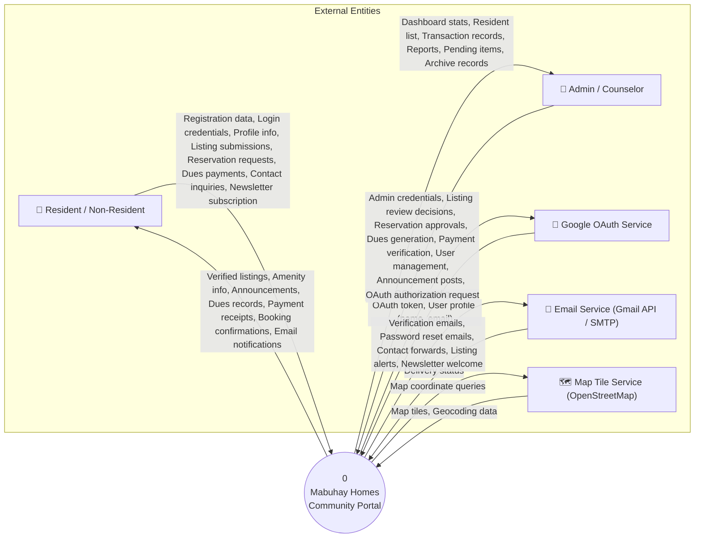
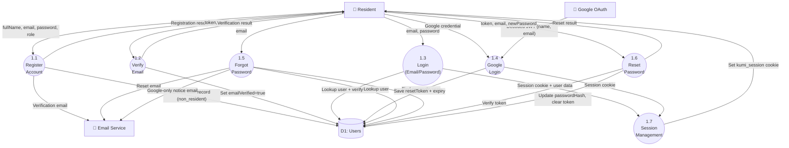
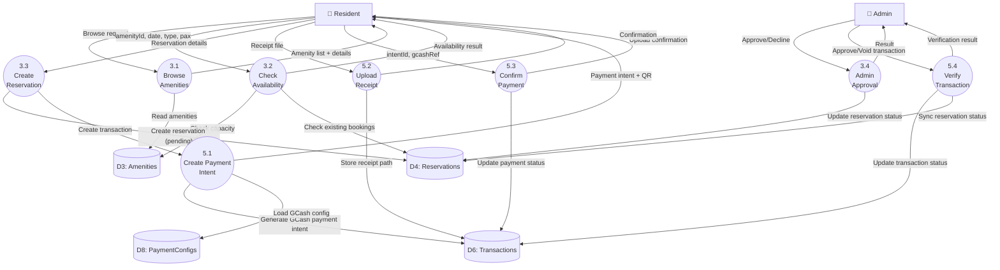
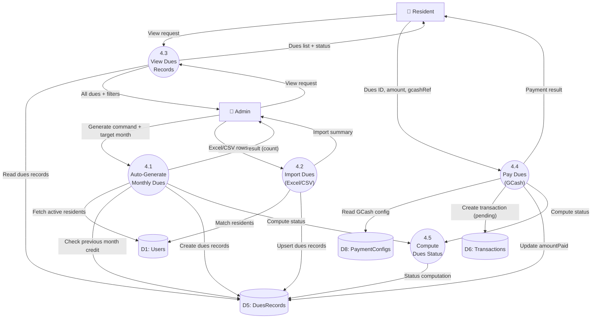
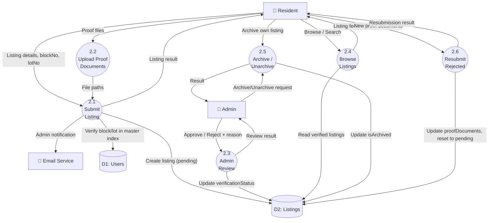

# Data Flow Diagrams (DFD) — Mabuhay Homes Community Portal

**Project:** Mabuhay Homes Community Portal  
**Audit Date:** 2026-10-13

---

## DFD Notation Guide

| Symbol | Meaning |
|--------|---------|
| Rectangle | External Entity |
| Rounded Rectangle / Circle | Process |
| Open-ended Rectangle | Data Store |
| Arrow | Data Flow (labeled) |

---

## A. Context Diagram (Level 0)

### Context Diagram Description

The entire Mabuhay Homes Community Portal is represented as a single process (Process 0). Four external entities interact with the system:

1. **Resident / Non-Resident** — End users who register, login, browse listings, make reservations, pay dues, and submit inquiries
2. **Admin / Counselor** — HOA administrators who manage all aspects of the subdivision portal
3. **Google OAuth Service** — Provides third-party authentication via Google Sign-In
4. **Email Service** — Gmail API (production) or SMTP (local) for transactional emails
5. **Map Tile Service** — OpenStreetMap/Leaflet for community and property maps

---

## B. Level 1 DFD

```mermaid
graph TB
    subgraph "External Entities"
        R["👤 Resident"]
        A["🔑 Admin"]
        G["🔐 Google OAuth"]
        E["📧 Email Service"]
    end

    subgraph "Processes"
        P1(("1.0\nAuthentication\n& Registration"))
        P2(("2.0\nListing\nManagement"))
        P3(("3.0\nAmenity &\nReservation"))
        P4(("4.0\nMonthly Dues\nManagement"))
        P5(("5.0\nPayment\nProcessing"))
        P6(("6.0\nAnnouncement\nManagement"))
        P7(("7.0\nProperty\nViewing"))
        P8(("8.0\nUser & Profile\nManagement"))
        P9(("9.0\nReports &\nDashboard"))
        P10(("10.0\nCommunication\n& Contact"))
    end

    subgraph "Data Stores"
        D1[("D1: Users")]
        D2[("D2: Listings")]
        D3[("D3: Amenities")]
        D4[("D4: Reservations")]
        D5[("D5: DuesRecords")]
        D6[("D6: Transactions")]
        D7[("D7: Announcements")]
        D8[("D8: PaymentConfigs")]
        D9[("D9: PropertyViewings")]
    end

    %% Authentication flows
    R -->|"Registration data, Credentials"| P1
    G -->|"OAuth token"| P1
    P1 -->|"Auth result, Session cookie"| R
    P1 -->|"Verification email request"| E
    P1 <-->|"User records"| D1

    %% Listing flows
    R -->|"Listing data, Proof documents"| P2
    A -->|"Verification decision"| P2
    P2 -->|"Listing feed, Details"| R
    P2 -->|"Listing notification"| E
    P2 <-->|"Listing records"| D2
    P2 -->|"Owner lookup"| D1

    %% Amenity & Reservation flows
    R -->|"Reservation request"| P3
    A -->|"Approve/Decline"| P3
    P3 -->|"Availability, Booking confirmation"| R
    P3 <-->|"Amenity records"| D3
    P3 <-->|"Reservation records"| D4
    P3 -->|"Transaction data"| P5

    %% Dues flows
    A -->|"Generate/Import dues"| P4
    R -->|"Payment request"| P4
    P4 -->|"Dues records, Status"| R
    P4 <-->|"Dues records"| D5
    P4 -->|"Resident lookup"| D1
    P4 -->|"Payment data"| P5

    %% Payment flows
    R -->|"GCash reference, Receipt upload"| P5
    A -->|"Payment verification, Config update"| P5
    P5 -->|"Transaction status"| R
    P5 <-->|"Transaction records"| D6
    P5 <-->|"Payment config"| D8
    P5 -->|"Status sync"| D4
    P5 -->|"Status sync"| D5

    %% Announcement flows
    A -->|"Create/Archive announcement"| P6
    P6 -->|"Active announcements"| R
    P6 <-->|"Announcement records"| D7

    %% Viewing flows
    R -->|"Viewing request"| P7
    A -->|"Schedule/Decline"| P7
    P7 -->|"Viewing status"| R
    P7 <-->|"Viewing records"| D9
    P7 -->|"Listing lookup"| D2

    %% User Management
    A -->|"CRUD operations, Role changes"| P8
    R -->|"Profile updates"| P8
    P8 <-->|"User records"| D1

    %% Reports
    A -->|"Report request"| P9
    P9 -->|"Dashboard stats, Reports"| A
    P9 -->|"Read"| D1
    P9 -->|"Read"| D2
    P9 -->|"Read"| D4
    P9 -->|"Read"| D5
    P9 -->|"Read"| D6

    %% Communication
    R -->|"Contact form, Newsletter"| P10
    P10 -->|"Forward inquiry"| E
    P10 -->|"Welcome email"| E
```

### Level 1 Process Descriptions

| Process | Input | Output | Data Stores Used |
|---------|-------|--------|-----------------|
| **1.0 Authentication & Registration** | Registration data, Login credentials, Google OAuth token | Session cookie, Auth result, Verification emails | D1 (Users) |
| **2.0 Listing Management** | Listing data, Proof documents, Verification decision | Listing feed, Listing details, Admin notifications | D2 (Listings), D1 (Users) |
| **3.0 Amenity & Reservation** | Reservation request, Approve/Decline decisions | Availability status, Booking confirmation | D3 (Amenities), D4 (Reservations) |
| **4.0 Monthly Dues Management** | Generate/Import command, Payment request | Dues records, Payment status | D5 (DuesRecords), D1 (Users) |
| **5.0 Payment Processing** | GCash ref, Receipt, Config updates, Verification | Transaction status, Receipt confirmation | D6 (Transactions), D8 (PaymentConfigs) |
| **6.0 Announcement Management** | Create/Archive announcement | Active announcements list | D7 (Announcements) |
| **7.0 Property Viewing** | Viewing request, Schedule/Decline decision | Viewing status | D9 (PropertyViewings), D2 (Listings) |
| **8.0 User & Profile Management** | CRUD operations, Profile updates | User records | D1 (Users) |
| **9.0 Reports & Dashboard** | Report request | Dashboard stats, Reports | D1-D6 (read-only) |
| **10.0 Communication & Contact** | Contact form, Newsletter signup | Forwarded inquiry, Welcome email | (none — email only) |

---

## C. Level 2 DFDs

### C.1 — Process 1.0: Authentication & Registration (Decomposed)

### C.2 — Process 3.0 + 5.0: Amenity Reservation & Payment (Decomposed)

### C.3 — Process 4.0: Monthly Dues Management (Decomposed)

### C.4 — Process 2.0: Listing Management (Decomposed)

