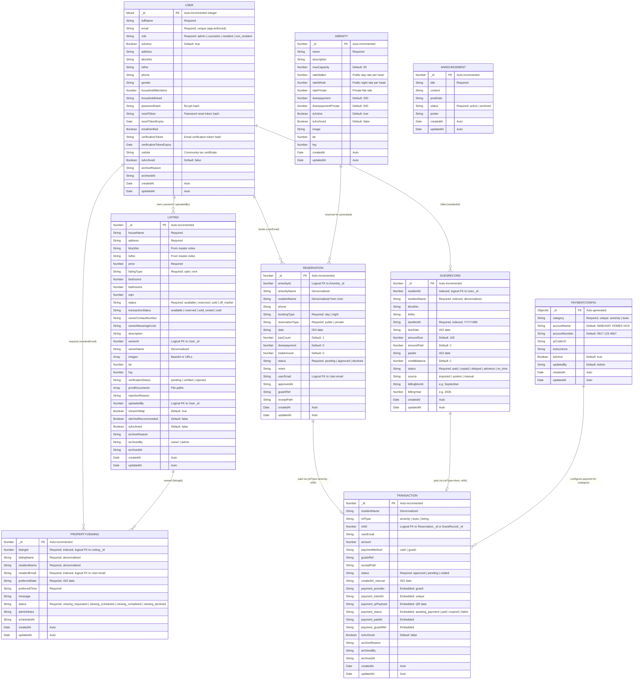

# Complete Entity Relationship Diagram (ERD) — Mabuhay Homes Community Portal

**Project:** Mabuhay Homes Community Portal  
**Database:** MongoDB (Mongoose ODM)  
**Audit Date:** 2026-10-13  
**Total Entities:** 9

---

## ERD Notes

- MongoDB is a **document database** — it does NOT enforce foreign keys at the database level
- Relationships shown below are **application-level logical relationships** enforced in code (`lib/db.ts`)
- Dashed lines (`..|..`) indicate logical/soft references (not database-enforced foreign keys)
- The `payment` field in Transaction is an **embedded subdocument**, NOT a separate collection
- Many fields are **denormalized** (e.g., `residentName` stored directly instead of joined) — this is a deliberate MongoDB design pattern

---

## Full ERD (Mermaid)

---

## Relationship Summary

| Relationship | Type | Enforced By | Notes |
|--------------|------|-------------|-------|
| User → Listing | One-to-Many | App code (`ownerId`, `uploadedBy`) | A user can own/upload multiple listings |
| User → Reservation | One-to-Many | App code (`userEmail`) | A user can make multiple reservations |
| User → DuesRecord | One-to-Many | App code (`residentId`) | One dues record per resident per month |
| User → PropertyViewing | One-to-Many | App code (`residentEmail`) | A user can request multiple viewings |
| Amenity → Reservation | One-to-Many | App code (`amenityId`) | An amenity can have multiple reservations |
| Listing → PropertyViewing | One-to-Many | App code (`listingId`) | A listing can have multiple viewing requests |
| Reservation → Transaction | One-to-One | App code (`refType="amenity"`, `refId`) | Each reservation links to one payment transaction |
| DuesRecord → Transaction | One-to-One | App code (`refType="dues"`, `refId`) | Each dues payment links to one transaction |
| PaymentConfig → Transaction | One-to-Many (indirect) | App logic | Config determines GCash details for transactions |

### Denormalized Fields (Intentional Redundancy)

These fields store data that *could* be derived from a join, but are stored directly for performance and simplicity in MongoDB:

| Entity | Field | Source |
|--------|-------|--------|
| Listing | `ownerName` | from User.fullName |
| Reservation | `amenityName` | from Amenity.name |
| Reservation | `residentName` | from User.fullName |
| DuesRecord | `residentName` | from User.fullName |
| DuesRecord | `blockNo`, `lotNo` | from User.blockNo, User.lotNo |
| Transaction | `residentName` | from User.fullName |
| PropertyViewing | `listingName` | from Listing.houseName |
| PropertyViewing | `residentName` | from User.fullName |

### Embedded Subdocument (NOT a Separate Collection)

The `Transaction.payment` field is an **embedded subdocument** within the Transaction document. It contains GCash payment details (`provider`, `intentId`, `qrPayload`, `status`, `paidAt`, `gcashRef`). This is NOT a separate collection — it is nested inside each transaction document. This is a standard MongoDB pattern for tightly-coupled 1:1 data.
